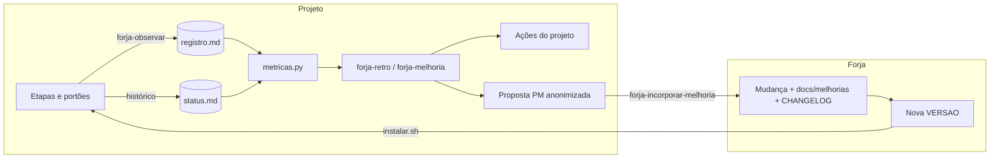

# Processo de melhoria contínua da Forja

A Forja melhora com os dados que os projetos já produzem ao usá-la. O ciclo tem duas metades: uma dentro de cada projeto e outra neste repositório.

## No projeto

| Quando | O que | Ferramenta |
|---|---|---|
| Ao concluir cada etapa | Ao menos uma observação | skill `forja-observar` |
| Em toda decisão de portão | Observação `retorno`, `atrito` ou `acerto` | skill `forja-portao` (automático) |
| Em retornos e pulos de etapa | Observação `retorno` ou `atrito` | skill `forja-avancar` (automático) |
| Ao fim de cada iteração, portão, fase e na DU7 | Retrospectiva com métricas | skill `forja-retro`, agente `forja-melhoria` |
| A qualquer momento | Panorama | `python3 .forja/scripts/metricas.py forja` ou `/forja-status` |

Arquivos em `forja/melhoria/`: `registro.md` (só cresce), `retros/`, `propostas/`.

Cada observação guarda a **versão da Forja** em uso. Assim, depois de uma atualização, a retro compara as observações e métricas antes e depois da mudança.

## Neste repositório

1. Alguém traz uma proposta `PM-nnn` de um projeto.
2. A skill `forja-incorporar-melhoria` confere a anonimização, aplica a menor mudança que resolve, registra em `docs/melhorias/`, incrementa `VERSAO` e escreve o `CHANGELOG.md`.
3. As verificações (`scripts/verificar.py`, `scripts/testar-instalacao.sh`, `scripts/testar-metricas.sh`) precisam passar.
4. PR revisado por quem mantém a Forja.

### Versionamento
- **patch** (0.2.x): texto, guias e templates.
- **minor** (0.x.0): agente, skill, script ou regra nova.
- **major** (x.0.0): mudança de fases, etapas ou portões.

### Anonimização
Nenhum nome de cliente, pessoa, sistema interno, link, e-mail ou número que identifique um projeto entra aqui. A evidência é descrita de forma genérica ("em 1 projeto, ...").
