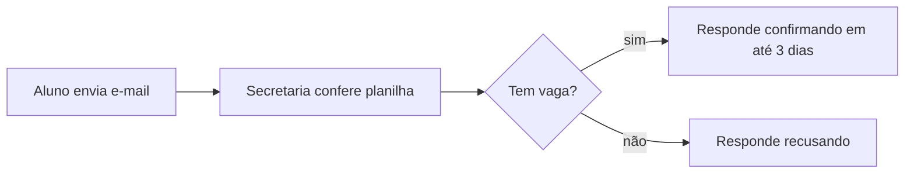
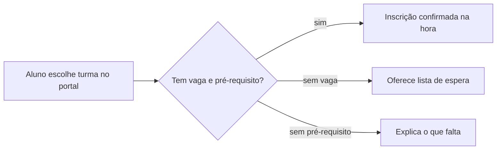

# D4 Processos AS-IS e TO-BE

<!-- Salvar em forja/produto/04-processos.md. Use Mermaid para os fluxos. -->

## AS-IS: inscrição

## TO-BE: inscrição

## Ganhos esperados
| Processo | Antes | Depois | Objetivo |
|---|---|---|---|
| Confirmação | até 3 dias | < 1 minuto | OBJ-01 |
