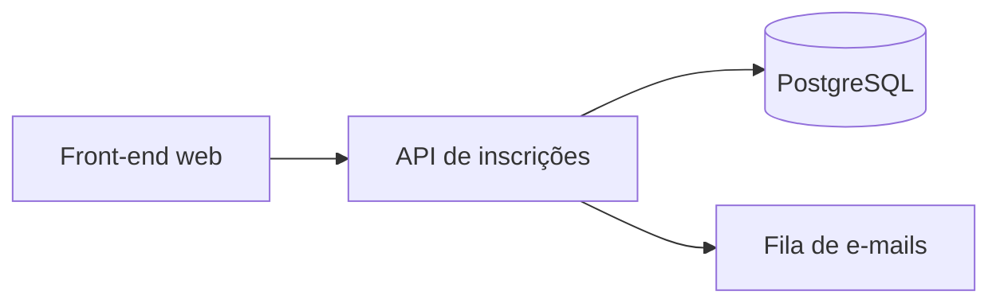

# DV1 Arquitetura e fundações

<!-- Nível do produto. Salvar em forja/arquitetura/01-arquitetura.md. Decisões estruturais viram ADRs (template adr.md). -->

## Visão de componentes

## Stack
| Camada | Escolha | ADR |
|---|---|---|
| Front-end | <ex.: React> | ADR-0002 |
| API | <ex.: Python + FastAPI> | ADR-0003 |
| Banco | PostgreSQL | ADR-0001 |

## RNF atendidos
| RNF | Como a arquitetura atende |
|---|---|
| RNF-02 | Transação curta com bloqueio por turma; índice em inscrições |

## Fundações
- Repositório, CI, ambientes (dev, homologação, produção).
- Comando de testes: `<comando>`; framework BDD: `<framework>`.
- Padrões de código e revisão.

## ADRs
| Id | Título | Situação |
|---|---|---|
| ADR-0001 | Banco de dados relacional para inscrições | aceito |
